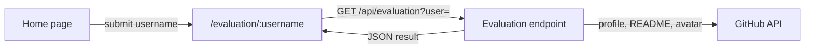

# Trybe GitHub Evaluator

[](https://github.com/rahelmartim/trybe-github-evaluator/actions/workflows/ci.yml)
[](https://tge-kappa.vercel.app)

A web app that grades a GitHub profile from 0 to 10. The grade comes from 10 criteria, for example a profile README, a LinkedIn link, and pinned repositories.

You type a GitHub username, and the app shows the grade, a chart, and the result of each criterion. The user interface is in Brazilian Portuguese because the app is for Trybe students.

Live demo: https://tge-kappa.vercel.app

## Criteria

Each criterion that passes adds 1 point to the grade.

| # | Criterion | How the app checks it |
| --- | --- | --- |
| 1 | Custom profile photo | The avatar is not the default GitHub identicon. |
| 2 | Profile README | The `<username>/<username>` repository has a README. |
| 3 | Email in the README | The README contains an email address or a `mailto:` link. |
| 4 | LinkedIn link | The profile social accounts, website, bio, or README link to `linkedin.com/in/`. |
| 5 | 5 or more technologies | The README names 5 or more known technologies. |
| 6 | 10 or more technologies | The README names 10 or more known technologies. |
| 7 | 5 or more repositories | The user owns 5 or more public repositories that are not forks. |
| 8 | 10 or more repositories | The user owns 10 or more public repositories that are not forks. |
| 9 | 2 or more pinned repositories | The profile pins 2 or more repositories. |
| 10 | 4 or more pinned repositories | The profile pins 4 or more repositories. |

The app finds technologies in three places: icon lists from [skillicons.dev](https://skillicons.dev), [devicon](https://devicon.dev) image URLs, and `logo=` parameters of [shields.io](https://shields.io) badges. It also finds technology names in the plain text of the README. The list of known technologies is in `server/technologies.ts`.

## How it works

The app has two parts:

- **Front end:** a React single-page app in `src/`.
- **Evaluation endpoint:** `GET /api/evaluation?user=<username>`, in `api/evaluation.ts`. It reads public profile data from the GitHub GraphQL and REST APIs and calculates the grade.



The endpoint needs a GitHub token, because the GraphQL API does not accept requests without one. The token stays on the server. The browser never receives it.

During `npm run dev`, Vite serves the endpoint. On Vercel, the endpoint runs as a serverless function.

## Tech stack

- [React 19](https://react.dev) with TypeScript
- [Vite](https://vite.dev) for the development server and the build
- [React Router](https://reactrouter.com) for routing
- [Tailwind CSS](https://tailwindcss.com) for styles
- [Chart.js](https://www.chartjs.org) for the grade chart
- [AOS](https://github.com/michalsnik/aos) for scroll animations
- [Phosphor Icons](https://phosphoricons.com) for icons
- [Vitest](https://vitest.dev) for unit tests
- [Vercel Functions](https://vercel.com/docs/functions) for the evaluation endpoint

## Getting started

You need Node.js 20 or later. The `.nvmrc` file contains the version that CI uses.

1. Clone the repository.

   ```bash
   git clone https://github.com/rahelmartim/trybe-github-evaluator.git
   cd trybe-github-evaluator
   ```

2. Install the dependencies.

   ```bash
   npm install
   ```

3. Create a GitHub token at https://github.com/settings/personal-access-tokens. A fine-grained token with public repository access only is enough.

4. Copy `.env.example` to `.env`, and set the token in `GITHUB_TOKEN`.

   ```bash
   cp .env.example .env
   ```

5. Start the development server.

   ```bash
   npm run dev
   ```

6. Open http://localhost:5173 in your browser.

## Scripts

| Command | Description |
| --- | --- |
| `npm run dev` | Starts the development server and the evaluation endpoint. |
| `npm run build` | Runs the type check and builds the front end into `dist/`. |
| `npm run preview` | Serves the `dist/` build on your computer. The evaluation endpoint is not available in this mode. |
| `npm test` | Runs the unit tests. |
| `npm run typecheck` | Runs the TypeScript type check only. |

## Configuration

| Variable | Required | Description |
| --- | --- | --- |
| `GITHUB_TOKEN` | Yes | GitHub token that the evaluation endpoint uses to read public profile data. |

## Routes

| Route | Page |
| --- | --- |
| `/` | Home page with the search form. |
| `/evaluation/:username` | Grade and criteria for one GitHub user. You can share this link. |
| `/tea` or `/418` | A small easter egg. |

Any other route shows the error page.

## Project structure

```text
api/
└── evaluation.ts   # Vercel function: GET /api/evaluation?user=<username>
server/             # Evaluation logic: GitHub client, criteria, technologies
shared/             # Types and validation that the server and the front end share
src/
├── api/            # Client for the evaluation endpoint
├── components/     # Reusable UI components
├── hooks/          # Theme (dark mode) context
├── lib/            # Grade tiers and criteria labels
├── pages/          # One component per route
├── styles/         # Tailwind entry file
├── App.tsx         # Route definitions
└── main.tsx        # App entry point
public/             # Static files: backgrounds, emojis, favicon
```

## Deployment

The app is deployed on [Vercel](https://vercel.com). To deploy your own copy, do these steps:

1. Import the repository in Vercel. Vercel detects the Vite project and the `api/` folder.
2. In the project settings, add the `GITHUB_TOKEN` environment variable.
3. Deploy.

The `vercel.json` file sends all routes, except `/api/*`, to `index.html`, so that React Router can handle them.

The GitHub API allows 5,000 requests per hour for one token. One evaluation uses two API requests and one avatar download. The endpoint tells the Vercel cache to keep each result for 10 minutes, so that repeated searches do not use the limit.

## Contributing

To contribute, fork this repository, make your changes on a new branch, and open a pull request. Before you open it, run `npm test` and `npm run build`, and make sure that both pass. You can also open an issue to report a bug or suggest a feature.

## Authors

- [rahelmartim](https://github.com/rahelmartim)
- [felipmartins](https://github.com/felipmartins)

## License

This project uses the MIT license. Read the [LICENSE](LICENSE) file for the full text.
