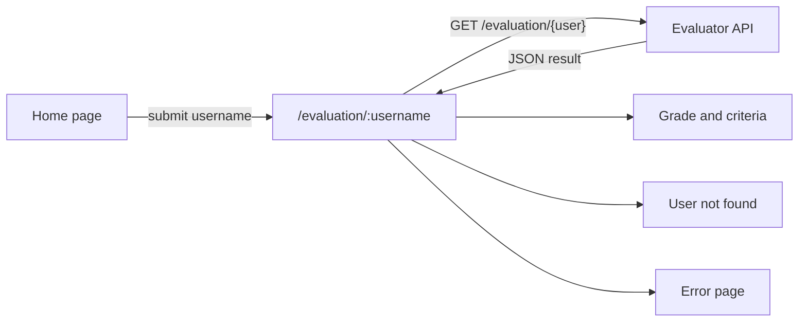

# Trybe GitHub Evaluator

[](https://github.com/rahelmartim/trybe-github-evaluator/actions/workflows/ci.yml)
[](https://tge-kappa.vercel.app)

A web app that grades a GitHub profile from 0 to 10. The grade comes from 10 criteria, for example a profile README, a LinkedIn link, and pinned repositories.

You type a GitHub username, and the app shows the grade, a chart, and the result of each criterion. The user interface is in Brazilian Portuguese because the app is for Trybe students.

Live demo: https://tge-kappa.vercel.app

## Criteria

Each criterion that passes adds 1 point to the grade.

1. The profile photo shows your face.
2. You have a profile README.
3. Your README contains your email address.
4. Your profile contains a link to LinkedIn.
5. Your README lists 5 or more technologies.
6. Your README lists 10 or more technologies.
7. You have 5 or more public repositories.
8. You have 10 or more public repositories.
9. You have 2 or more pinned repositories.
10. You have 4 or more pinned repositories.

The evaluation itself runs in the evaluator API (`https://github-profile-evaluator.betrybe.dev`). This repository contains only the front end.

## Tech stack

- [React 19](https://react.dev) with TypeScript
- [Vite](https://vite.dev) for the development server and the build
- [React Router](https://reactrouter.com) for routing
- [Tailwind CSS](https://tailwindcss.com) for styles
- [Chart.js](https://www.chartjs.org) for the grade chart
- [AOS](https://github.com/michalsnik/aos) for scroll animations
- [Phosphor Icons](https://phosphoricons.com) for icons

## Getting started

You need Node.js 20 or later. The `.nvmrc` file contains the version that CI uses.

1. Clone the repository.

   ```bash
   git clone https://github.com/rahelmartim/trybe-github-evaluator.git
   cd trybe-github-evaluator
   ```

2. Install the dependencies.

   ```bash
   npm install
   ```

3. Start the development server.

   ```bash
   npm run dev
   ```

4. Open http://localhost:5173 in your browser.

## Scripts

| Command | Description |
| --- | --- |
| `npm run dev` | Starts the development server with hot reload. |
| `npm run build` | Runs the type check and builds the app into `dist/`. |
| `npm run preview` | Serves the `dist/` build on your computer. |
| `npm run typecheck` | Runs the TypeScript type check only. |

## Configuration

The app reads one optional environment variable. To change it, copy `.env.example` to `.env` and edit the value.

| Variable | Default | Description |
| --- | --- | --- |
| `VITE_EVALUATOR_API_URL` | `https://github-profile-evaluator.betrybe.dev` | Base URL of the evaluator API. |

## Routes

| Route | Page |
| --- | --- |
| `/` | Home page with the search form. |
| `/evaluation/:username` | Grade and criteria for one GitHub user. You can share this link. |
| `/tea` or `/418` | A small easter egg. |

Any other route shows the error page.

## How it works



The evaluation page loads its own data from the URL. For this reason, a page refresh or a shared link shows the same result.

## Project structure

```text
src/
├── api/          # Evaluator API client and response types
├── components/   # Reusable UI components
├── hooks/        # Theme (dark mode) context
├── lib/          # Grade tiers and criteria labels
├── pages/        # One component per route
├── styles/       # Tailwind entry file
├── App.tsx       # Route definitions
└── main.tsx      # App entry point
public/           # Static files: backgrounds, emojis, favicon
```

## Deployment

The app is deployed on [Vercel](https://vercel.com). The `vercel.json` file sends all routes to `index.html`, so that React Router can handle them.

## Contributing

To contribute, fork this repository, make your changes on a new branch, and open a pull request. Before you open it, run `npm run build` and make sure that the build passes. You can also open an issue to report a bug or suggest a feature.

## Authors

- [rahelmartim](https://github.com/rahelmartim)
- [felipmartins](https://github.com/felipmartins)

## License

This project uses the MIT license. Read the [LICENSE](LICENSE) file for the full text.
